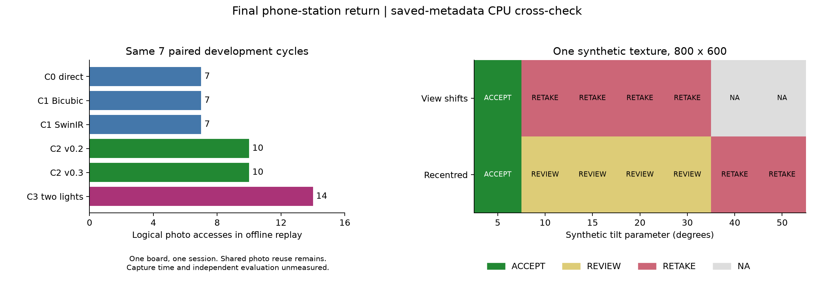

# 주형 최종 반환 CPU 검토

검토일은2026년11월17일 KST다. 반환 `handoff/juhyung@59bc262a2381de5e7edd9ca2dddf377185fc26d8`의22개 metadata를 receipt의 bytes/SHA256과 대조했다. 실행 source는 `7b868a34e9ed6c423e2a127bde12eae8687dfb21`, 포스터 생성 source는 `59db971`이다. 코드4개와 문서3개의 해시는 Git blob 또는 원래 줄바꿈의 checkout 사본에서 일치했다. 출처별 표현은 CROSSCHECKS.json에 기록했다.

현재 완료 범위는 받은 코드·문서·CSV·로그 검토다. 실제 포스터 PPTX/PDF, 그림7개, 최신 시연 HTML과 새 private 원문은 아직 CPU에 도착하지 않았다. 이 파일의 배치·화질과 새 원문 통합은 수신 뒤 이어간다.

## 구현과 개발 결과

v0.3은 선명도와 신규 clipping을 같은 조명의 참조와 비교한다. v0.2의 밝기제곱 정규화가 L1의 디지털 흐림을 통과시킨 개발 사례를 근거로 추가됐다. 실제 L1 초점 흐림과 사람 판독 자료는 없다. 새32장 평가의 참조·보정·평가 분리 계획과 사람 판독표는 준비된 상태다.

입력표에서 실행 계획과 운영 결과표를 만드는 경로, 잘못된 recipe·누락 파일·덮어쓰기 거부, 원근 상태 판단과 UNO fake serial 경로의 신규 테스트4개가 CPU에서 통과했다. 실물 UNO와 스케치 컴파일은 담당자 기록에서도 미실시다.

기존 metadata consumer에 알려진7조건 반환 지원을 추가했다. 기존6조건 회귀 검사를 포함한11개 테스트가 통과했다. 실제112cell과21개 cohort 요약을 재집계했다.

| 같은 두 조명7 cycle | OK | NG | 사진의 논리적 사용 횟수 |
|---|---:|---:|---:|
| C0 | 3 | 4 | 7 |
| C1 Bicubic | 4 | 3 | 7 |
| C1 SwinIR | 4 | 3 | 7 |
| C2 v0.2 | 4 | 3 | 10 |
| C2 v0.3 | 4 | 3 | 10 |
| C3 | 3 | 4 | 14 |

전체16건에서 v0.2/v0.3은 OK6·NG4·REVIEW6, 사진 사용19회로 같았다. 공통7건에서는 두 정책 모두 정상라벨 NG0/4, 모사 이물 NG3/3이다. 참조·보정 재사용2건을 제외한 사후5건의 C2v0.3/C3 사진 사용은6/10회다. 같은 대체 사진과 한 보드·한 세션 반복이 남는다.

기존96cell은 최종 판정·사진 사용·재촬영 요청·첫/두번째 품질 상태·점수·한계값이 이전 반환과 모두 같았다.24사진 해시 목록, 참조·보정·cycle 계획과 golden-reference 보정표도 이전 cache와 일치했다. 운영 결과표16행은 C2v0.3 cell과 일치했다.

v0.3 품질 CSV는24사진×가정 조명2개의48행이다. 실제 recipe 조명(L1/F1은L1, 나머지는L0)을 고르면 PASS15·REVIEW9다.48행을 사진48장으로 집계하지 않는다. 사람 판독이 없어 정책의 정확도 순위는 미확정이다.

## 수정할 설명

### 원근 입력 두 종류를 명시한다

합성32행은 ACCEPT10·REVIEW12·RETAKE10이다. 중심을 다시 맞춘 `tilt_recentred_deg`는5도 ACCEPT,10~30도 REVIEW,40~50도 RETAKE다. 화면이 함께 밀리는 `tilt_deg`는5도 ACCEPT,10~20도는 ROI 소실로 RETAKE,30도는 정렬 임계값 미달로 RETAKE다.

FINAL_REPORT §6.5와 FINAL_REVIEW의 원근 요약에 중심 보정 조건을 추가한다. 한 texture와 측정 grid의 결과이며 실제 라인의 보장 허용각으로 확대하지 않는다. 수치는 registration_summary.csv와 반환 원자료에 연결된다.

### 실행 시간의 원인을 분리한다

147초는5839caa의6조건,423초는7b868a3의7조건 실행이다. 전원과 코드·조건 수가 함께 다르고, 중간6748c95의633초 실행은 pytest와 겹쳤다. FINAL_REPORT §7과 FINAL_REVIEW의 ‘전원 상태에 따라 약3배’는 원인 추정이다.

‘서로 다른 코드·조건 수·전원·동시 부하에서147/423초를 관측했으며 전원 효과만 분리한 비교는 미실시’로 고친다. 새 시간 실험은 추가하지 않았다. 물리 촬영시간도 미측정이다.

### 포스터의 지표와 seed 표현을 고친다

포스터 생성기의 ‘평균 AU-PRO는 오르지만’과 그림B의 ‘평균은 개선(pooled AU-PRO …)’는 `pooled AU-PRO`로 통일한다. Pooled 지표와 영상별 산술평균을 같은 값으로 쓰지 않는다.

동결57235a2 master에서 Hazelnut 이상70장 중 저하30장, suppression14/geometry candidate16, 나머지40장을 확인했다. Screw·PCB 인용 수치도 반올림 범위에서 일치했다.165조건은8family이며 historical_recovery의 seed는 미기록이고 PCB native full cohort는11이다. 공통 ‘bank/split seed11’은 family별 근거가 확인된 범위로 고친다.

### 최종 포스터 정보와 화면 표기를 채운다

생성기는 `Team No_??`를 남기고 담당자 보고서도 팀번호·저자·소속·제목을 미확정으로 적었다. 사용자 검토용 초안 상태를 표시하고 제출 전에 실제 정보를 채운다. HTML banner의 결정 문서가v0.2만 가리킨다는 자체 검토 항목도 운영v0.3과 맞춘다. 실제 포스터와 HTML은 미수신이므로 최종 화면 검증은 대기한다.

## 검사 기록과 모델 출처

CPU에서 consumer11개가0.84초, source 신규4개가105.50초에 통과했다. 후자는 원근 범위·같은 조명 품질·입력표 계획·CLI/UNO fake E2E다. 기존7개 source 시험은 이번에 재실행하지 않았다.

담당자 로그는 전체 pytest696 passed/4 skipped(6748c95), 관련49 passed와 smoke2행/exit0(7b868a3)을 포함한다.6748c95→7b868a3은 검사/보고서 시간 분리와 테스트 기대값 수정임을 diff로 확인했다. 이전5839caa smoke는 당시 로그를 저장하지 않았다는 기록이며 최종 source의 새 로그가 수신됐다.

RUN_RECORD는 설계·구현·원고·그림·포스터·자체 검토를 Fable5.2,11월16일12시10분 KST 이후 기록·묶음·commit/push를 사용자 전환 요청에 따른 Opus5.5로 구분한다. 이는 담당자 실행 기록의 표기다. 자체 검토는 같은 모델·세션에서 수행했다.

새 GPU 추론이나 전체 pytest를 CPU에서 반복하지 않았다. 검증 범위는 VERIFICATION.json과 CROSSCHECKS.json, 실제 cohort 수치는 cohort_summary.csv에 있다. 새 private 원문과 시각 파일이 도착하면 해당 부분을 이어 검토한다.
