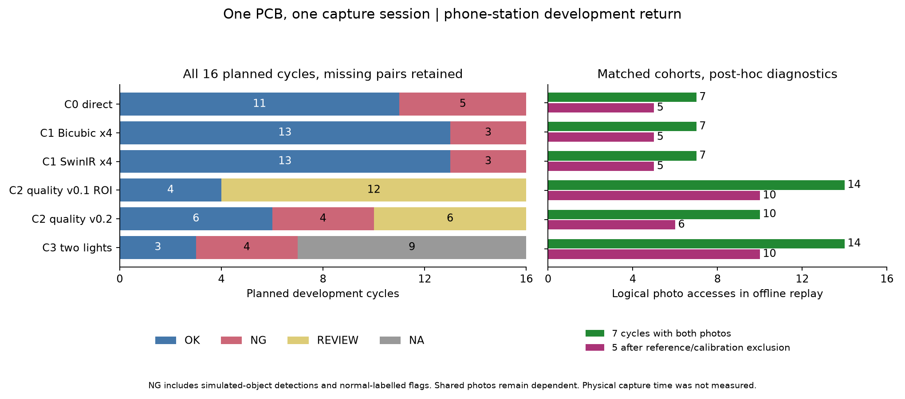

# 11월 15일 스마트폰 촬영 스테이션 반환 검토

주형의 공개 반환 `handoff/juhyung@7b2c8940ff1852da8ca1dd4f642bcfe12b49c4c1`과 실제 사진 24장을 연결했다. 실행 source는 `exp/phone-lighting-juhyung@5839caae0150073eb2738a50cc1cc2a999d832e7`이다. 담당자 실행 기록에 사용 모델이 Claude Fable 5.2 (`claude-fable-5-2`)로 적혀 있다.

반환 metadata 17개와 실제 JPEG 24개의 바이트 수·SHA256을 receipt/manifest와 대조했다. 실행 source 6개와 이전 예시 사진 6개의 해시도 일치했다. 이전 예시 사진은 이번 반환에 등록되어 있어 담당자 측 수신이 확인된다. 실제 사진과 GPS EXIF는 비공개 경로에 보관했다.

## 이번에 확인한 구현과 사진

한 그래픽카드 뒷면을 촬영한 4000×3000 JPEG 24장이다. L0·L1·저조도·흐림·모사 이물의 두 조명·배경·회전 조건이 각 3장이다. 모사 이물은 같은 물체와 위치를 반복했다. 육안으로 촬영 조건의 변화를 확인했으며 개별 소자의 전기적 정상 여부와 실제 제조 결함 라벨은 미확인이다.

고정 recipe/ROI, 정상 참조에 대한 품질 정책 v0.2, 조명별 golden-reference 차영상 검사, 최대 1회 대체 촬영, C0~C3 비교와 소프트웨어 스테이션 재생이 연결됐다. v0.2는 ROI의 밝기·신규 clipping·참조 대비 선명도·자세를 검사한다. Golden-reference는 정상 참조·보정 사진으로 정한 임계값과 최대 연결 성분 크기로 판정한다. 사후 이물 위치 표시는 위치 일치 확인에만 사용한다.

같은 세션의 v0.1 감사와 사진을 본 뒤 v0.2를 설계했다. 자세 허용 5도·배율 편차 0.10, RGB 차이 사용, 합성 입력으로 수정한 임계값도 이 개발 과정에 포함된다. 이번 결과는 개발 자료로 기록한다. 다음 평가에서는 새 입력을 보기 전에 방법과 기준을 고정한다.

## 전체 16개 계획 사례의 판정

다음 표는 반환 `cycles.csv` 96행에서 다시 계산했다. ERROR와 PENDING은 모두 0이다. NG에는 모사 이물 검출과 정상 라벨 사진의 NG가 함께 들어간다.

| 조건 | OK | NG | REVIEW | NA | 사진 사용 횟수 |
|---|---:|---:|---:|---:|---:|
| C0 직접 검사 | 11 | 5 | 0 | 0 | 16 |
| C1 Bicubic x4 | 13 | 3 | 0 | 0 | 16 |
| C1 SwinIR x4 | 13 | 3 | 0 | 0 | 16 |
| C2 v0.1 ROI | 4 | 0 | 12 | 0 | 23 |
| C2 v0.2 | 6 | 4 | 6 | 0 | 19 |
| C3 항상 두 조명 | 3 | 4 | 0 | 9 | 14 |

C3의 9개 NA는 흐림·배경·회전 사례에 두 번째 사진이 없어 발생했다. 전체 16건의 C2 19회와 C3 14회를 그대로 촬영 부담 비교에 쓰면 분모가 달라진다. 기존 사진을 오프라인으로 재생한 논리적 사용 횟수이며 실제 조건부 재촬영·노출 시간·라인 처리량은 측정하지 않았다.

## 같은 사례로 맞춘 재집계

이 검토에서 사후 진단용으로 두 묶음을 만들었다. 방법 선택과 평가 성능 추정에는 사용하지 않았다.

- 두 조명 사진이 있는 7건에서 C2 v0.2는 OK 4·NG 3, 사진 사용 10회다. C3는 OK 3·NG 4, 사용 14회다. 모사 이물 3건은 두 조건 모두 NG다. 정상 라벨 4건 중 NG는 C2 0건, C3 1건이다.
- 참조·보정 사진을 대체 촬영으로 재사용한 `lowlight-1`, `lowlight-2`를 제외하면 5건이다. C2는 OK 2·NG 3, 사용 6회다. C3는 OK 1·NG 4, 사용 10회다. `normal-3`과 `lowlight-3`은 같은 대체 사진을 공유한다.

7건과 5건 모두 한 보드·한 세션 안의 반복이다. 두 번째 묶음에도 사진 재사용과 같은 이물 반복이 남는다. 독립 표본으로 계산한 신뢰구간이나 공장 오탐률은 제시하지 않았다. 재사용 관계는 [source_reuse.csv](source_reuse.csv), 묶음 구성은 [cohort_membership.csv](cohort_membership.csv)에 남겼다.



## 복원과 품질 정책의 해석

Bicubic과 SwinIR의 최종 판정은 전체 16건에서 모두 같았다. 원본 직접 검사에서 정상 라벨 NG 2건, 두 복원 조건에서 각각 0건이지만 SwinIR 고유의 이득은 이 결과로 확인되지 않는다. C1은 작업 해상도에서 0.25배 축소 후 x4 복원한 별도 `phone_x4_roundtrip` 실험이다. 원래 카메라 사진에 존재하는 흐림·잡음만 복원한 조건과 구별해 기록한다.

v0.1 전체 화면 감사는 PASS 3·REVIEW 3·RETAKE 18이고, ROI v0.1은 PASS 3·REVIEW 6·RETAKE 15다. v0.2는 PASS 15·REVIEW 9·RETAKE 0이다. v0.2의 REVIEW는 저조도·흐림·회전 각 3장이다. 사람이 실제 검사 정보를 읽을 수 있는지에 대한 라벨이 없어 이 수치를 품질 오수락·오거절률로 환산할 수 없다.

밝기의 제곱으로 나눈 선명도는 어두운 사진에서 참조 대비 3배 이상으로 증가한다. 현재 저조도는 별도 밝기 게이트가 처리한다. 선명도 정규화가 조명에 무관하다는 주장은 보류한다. L0와 L1의 golden-reference 임계값도 약 1.615와 0.533으로 달라 조명별 참조·보정을 유지해야 한다.

## 현업 촬영을 반영한 후속 범위

이 프로젝트의 우선 비교군은 고정 촬영·직접 golden-reference 검사 C0와 고정 두 조명 검사 C3로 둔다. C2는 같은 사례에서 판정과 추가 사진 부담을 비교하고, C1에는 Bicubic을 유지한다. 모델 복원 결과와 촬영 조건 통제를 함께 평가하기 위한 프로젝트 설계 선택이다. 현업 자료와 촬영 원칙은 기존 `docs/INDUSTRIAL_CAPTURE_COMPARISON_20261113.md`에 연결되어 있다.

주형 담당의 다음 유한 작업은 [후속 실행 문서](../../docs/PHONE_STATION_REVIEW_NEXT_20261115.md)에 있다. 기존 결과·포스터 수치 정리는 바로 진행할 수 있다. 새 평가 촬영은 참조·보정·평가 사진의 분리, 조명 위치 고정, 같은 사례의 두 조명 입력, 물리 촬영 시간 기록을 포함한 작은 계획을 먼저 고정한다.

## 검증과 재현

새 consumer `scripts/analyze_phone_station_return.py`는 저장 CSV/JSON만 읽는다. 중복·누락 cell, 조건별 사례 불일치, 잘못된 상태·사진 예산, 원본 summary 불일치와 출력 덮어쓰기를 검사한다. 기존 `analysis_io`를 재사용한다. 독립 재집계에서 원본 summary와 모든 상태·사용 횟수가 일치했다.

- 새 consumer의 합성 metadata 테스트 9개가 0.40초에 통과했다.
- 실행 source의 기존 CPU 테스트 7개가 137.68초에 통과했다. 복원기는 fake를 사용했다.
- 보고서 그림과 실제 사진의 비공개 인화판을 직접 확인했다. 첫 그림에서 겹친 범례를 고쳐 다시 확인했다.

전체 테스트와 실제 GPU 복원 추론은 이번 CPU 검토에서 실행하지 않았다. 반환 픽셀 판정 맵과 원본 `capture_sheet.csv`는 제공되지 않았다. source와 scalar metadata를 검토했고 실제 사진 해시를 대조했다. 기존 165조건 연구 결과와 bank·split·calibration 기록은 별도로 유지한다.

아래 명령은 저장 metadata만 재집계한다. 출력 디렉터리는 새 경로를 지정한다.

```powershell
python scripts/analyze_phone_station_return.py --input handoff/returns/juhyung/phone-station-dev-20261115 --output outputs/phone-station-recount
```

상세 수치는 [cohort_summary.csv](cohort_summary.csv), 출처 해시는 [analysis.json](analysis.json), 검사 기록은 [VERIFICATION.json](VERIFICATION.json)에 있다.
