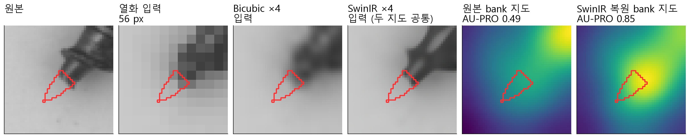
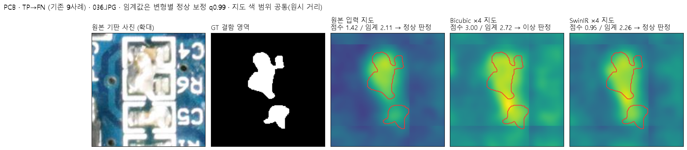
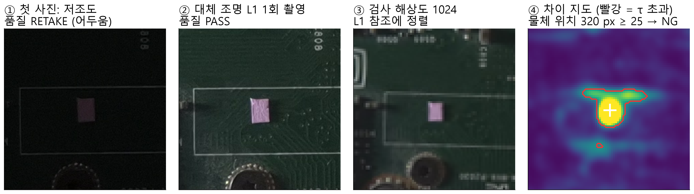

# 보고서에 쓸 그림

원자료를 찾을 때는 각 사례 목록과 [그림 출처 표](figure-provenance.csv)를 함께 보면 된다.

## 같은 결함 위치의 전후 비교

고정 SwinIR 입력을 원본 bank와 SwinIR bank로 각각 검사한 사례다. 아래 목록에는 일반 ×4, 흐림, 노이즈에서 관찰된 개선·감소·형태 변화 후보와 변화가 작은 사례가 있다. [MVTec 확대·bank 사례 전체](figures/mvtec/README.md)

## PCB 미검·오검 전환

정상 보정으로 정한 모델별 운영점에서 Bicubic은 검출, SwinIR은 미검인 사례다. 네 사례의 판정과 위치 지도는 [PCB 운영점 사례 전체](figures/visa/README.md)에 있다.

## 실물 PCB 촬영과 검사

같은 기판의 대체 촬영으로, 첫 저조도 사진을 소프트웨어로 복원한 조건과는 실험 경로가 다르다. [개발 24장, 평가 50장, 모사 이물 확대](figures/phone/README.md)

[고해상도 실물 74장과 추가 비교 그림](local-evidence/README.md)

## 수치 결과

- [Hazelnut 위치 결과와 반복 노이즈 비교](figures/overview/benchmark.png)
- [Screw 이미지 점수 집계](figures/overview/screw-aggregation.png)
- [Screw 정상 특징 bank 비교](figures/overview/bank-domain.png)
- [개발 세션 품질 정책](figures/overview/development-quality.png) · [정책별 사진 사용과 판정](figures/overview/development-policy-comparison.png)
- [50장 세션 고정·개발 운영 결과](figures/overview/eval-outcomes.png) · [검사 흐름](figures/overview/station-flow.png)

[데이터와 그림의 라이선스](FIGURE_LICENSES.md)
