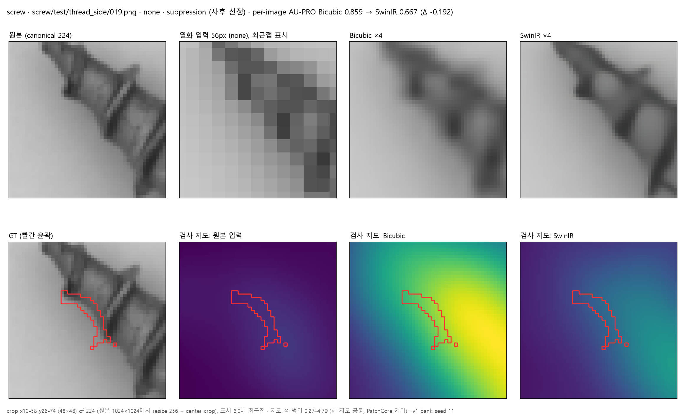

# MVTec AD 결함 확대와 정상 특징 비교

동일 결함 위치에서 원본, 열화 입력, Bicubic, SwinIR과 이상 지도를 비교한다. 그림의 선택은 사후 사례 분석이다. 열화별 집계는 [사례 목록](../../data/mvtec/defect-zoom-cases.csv)에 있다. 확대가 만들어지지 않은 1사례도 표에 표시돼 있다. [출처와 라이선스](../../FIGURE_LICENSES.md)

## 원본·열화·Bicubic·SwinIR 확대 23사례

- [hazelnut__blur_s1.6__geometry_candidate__crack_013](defect-zoom/hazelnut__blur_s1.6__geometry_candidate__crack_013.png)
- [hazelnut__blur_s1.6__improvement__cut_000](defect-zoom/hazelnut__blur_s1.6__improvement__cut_000.png)
- [hazelnut__blur_s1.6__small_change__hole_015](defect-zoom/hazelnut__blur_s1.6__small_change__hole_015.png)
- [hazelnut__blur_s1.6__suppression__crack_014](defect-zoom/hazelnut__blur_s1.6__suppression__crack_014.png)
- [hazelnut__noise_s15__geometry_candidate__crack_013](defect-zoom/hazelnut__noise_s15__geometry_candidate__crack_013.png)
- [hazelnut__noise_s15__improvement__hole_006](defect-zoom/hazelnut__noise_s15__improvement__hole_006.png)
- [hazelnut__noise_s15__small_change__cut_004](defect-zoom/hazelnut__noise_s15__small_change__cut_004.png)
- [hazelnut__noise_s15__suppression__cut_002](defect-zoom/hazelnut__noise_s15__suppression__cut_002.png)
- [hazelnut__none__geometry_candidate__crack_013](defect-zoom/hazelnut__none__geometry_candidate__crack_013.png)
- [hazelnut__none__improvement__crack_006](defect-zoom/hazelnut__none__improvement__crack_006.png)
- [hazelnut__none__small_change__print_002](defect-zoom/hazelnut__none__small_change__print_002.png)
- [hazelnut__none__suppression__crack_001](defect-zoom/hazelnut__none__suppression__crack_001.png)
- [screw__blur_s1.6__geometry_candidate__thread_side_000](defect-zoom/screw__blur_s1.6__geometry_candidate__thread_side_000.png)
- [screw__blur_s1.6__improvement__scratch_head_019](defect-zoom/screw__blur_s1.6__improvement__scratch_head_019.png)
- [screw__blur_s1.6__small_change__scratch_head_023](defect-zoom/screw__blur_s1.6__small_change__scratch_head_023.png)
- [screw__blur_s1.6__suppression__scratch_head_001](defect-zoom/screw__blur_s1.6__suppression__scratch_head_001.png)
- [screw__noise_s15__geometry_candidate__thread_top_020](defect-zoom/screw__noise_s15__geometry_candidate__thread_top_020.png)
- [screw__noise_s15__improvement__thread_top_022](defect-zoom/screw__noise_s15__improvement__thread_top_022.png)
- [screw__noise_s15__small_change__scratch_neck_008](defect-zoom/screw__noise_s15__small_change__scratch_neck_008.png)
- [screw__noise_s15__suppression__scratch_head_020](defect-zoom/screw__noise_s15__suppression__scratch_head_020.png)
- [screw__none__improvement__manipulated_front_023](defect-zoom/screw__none__improvement__manipulated_front_023.png)
- [screw__none__small_change__thread_top_006](defect-zoom/screw__none__small_change__thread_top_006.png)
- [screw__none__suppression__thread_side_019](defect-zoom/screw__none__suppression__thread_side_019.png)

## Hazelnut bank 교체 후 8사례

- [hazelnut_seed11_bicubic_x4_geometry_candidate](bank-taxonomy-hazelnut/hazelnut_seed11_bicubic_x4_geometry_candidate.png)
- [hazelnut_seed11_bicubic_x4_improvement](bank-taxonomy-hazelnut/hazelnut_seed11_bicubic_x4_improvement.png)
- [hazelnut_seed11_bicubic_x4_small_change](bank-taxonomy-hazelnut/hazelnut_seed11_bicubic_x4_small_change.png)
- [hazelnut_seed11_bicubic_x4_suppression](bank-taxonomy-hazelnut/hazelnut_seed11_bicubic_x4_suppression.png)
- [hazelnut_seed11_swinir_x4_geometry_candidate](bank-taxonomy-hazelnut/hazelnut_seed11_swinir_x4_geometry_candidate.png)
- [hazelnut_seed11_swinir_x4_improvement](bank-taxonomy-hazelnut/hazelnut_seed11_swinir_x4_improvement.png)
- [hazelnut_seed11_swinir_x4_small_change](bank-taxonomy-hazelnut/hazelnut_seed11_swinir_x4_small_change.png)
- [hazelnut_seed11_swinir_x4_suppression](bank-taxonomy-hazelnut/hazelnut_seed11_swinir_x4_suppression.png)

## Screw bank 교체 후 8사례

- [screw_seed11_bicubic_x4_geometry_candidate](bank-taxonomy-screw/screw_seed11_bicubic_x4_geometry_candidate.png)
- [screw_seed11_bicubic_x4_improvement](bank-taxonomy-screw/screw_seed11_bicubic_x4_improvement.png)
- [screw_seed11_bicubic_x4_small_change](bank-taxonomy-screw/screw_seed11_bicubic_x4_small_change.png)
- [screw_seed11_bicubic_x4_suppression](bank-taxonomy-screw/screw_seed11_bicubic_x4_suppression.png)
- [screw_seed11_swinir_x4_geometry_candidate](bank-taxonomy-screw/screw_seed11_swinir_x4_geometry_candidate.png)
- [screw_seed11_swinir_x4_improvement](bank-taxonomy-screw/screw_seed11_swinir_x4_improvement.png)
- [screw_seed11_swinir_x4_small_change](bank-taxonomy-screw/screw_seed11_swinir_x4_small_change.png)
- [screw_seed11_swinir_x4_suppression](bank-taxonomy-screw/screw_seed11_swinir_x4_suppression.png)

## 검사 입력 고정과 bank 비교 6사례

- [hazelnut_seed11_closest_to_zero_print_004](bank-fixed-query/hazelnut_seed11_closest_to_zero_print_004.png)
- [hazelnut_seed11_largest_decrease_crack_007](bank-fixed-query/hazelnut_seed11_largest_decrease_crack_007.png)
- [hazelnut_seed11_largest_increase_cut_013](bank-fixed-query/hazelnut_seed11_largest_increase_cut_013.png)
- [screw_seed11_closest_to_zero_scratch_neck_008](bank-fixed-query/screw_seed11_closest_to_zero_scratch_neck_008.png)
- [screw_seed11_largest_decrease_manipulated_front_020](bank-fixed-query/screw_seed11_largest_decrease_manipulated_front_020.png)
- [screw_seed11_largest_increase_thread_side_011](bank-fixed-query/screw_seed11_largest_increase_thread_side_011.png)

## Bicubic 정상 bank 고정과 검사 입력 비교 6사례

- [01_screw__test__thread_side__019](bicubic-bank-maps/01_screw__test__thread_side__019.png)
- [02_screw__test__thread_side__010](bicubic-bank-maps/02_screw__test__thread_side__010.png)
- [03_screw__test__scratch_head__005](bicubic-bank-maps/03_screw__test__scratch_head__005.png)
- [04_screw__test__manipulated_front__023](bicubic-bank-maps/04_screw__test__manipulated_front__023.png)
- [05_screw__test__scratch_neck__000](bicubic-bank-maps/05_screw__test__scratch_neck__000.png)
- [06_screw__test__scratch_neck__006](bicubic-bank-maps/06_screw__test__scratch_neck__006.png)

## 저장한 이상 지도 결합 2사례

- [case-1](map-gating/case-1.png)
- [case-2](map-gating/case-2.png)

Bicubic bank 이상 지도 [사례 인덱스](../../data/bank/bicubic-map-index.csv)와 [선정 수치 배열](../../data/bank/screw-seed11-bicubic-bank-selected-maps.npz)을 함께 제공한다. 이 여섯 지도는 고정 검사 입력의 bank 비교 여섯 사례와 다른 표본이다.
