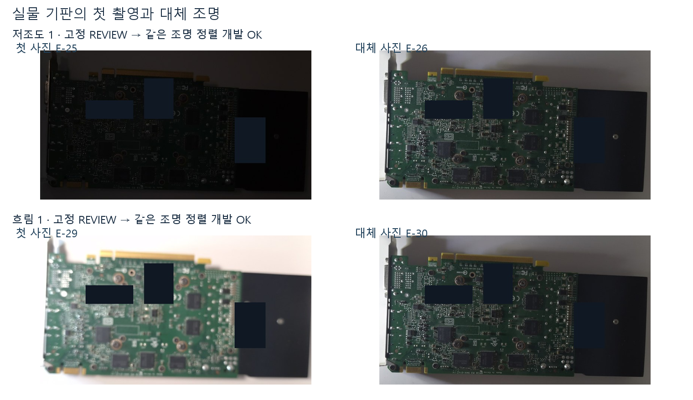

# 스마트폰 실물 기판 결과

촬영 순서 D는 첫 개발 세션, E는 별도 평가 세션이다. 각 샷과 조명·조건은 [개발 촬영표](../../data/phone/development-captures.csv), [평가 촬영표](../../data/phone/evaluation-capture-plan.csv)에 있다. 공개 사진에는 식별 스티커를 가렸고 EXIF를 제거했다.

## 같은 위치 확대

모사 이물 15검사건의 첫 사진과 대체 사진을 각각 확대했다. 확대한 이물 위치 표시는 사후 표시다.

- [고정 방법의 이물 사례 수치](../../data/phone/object_cases_fixed/object_cases.csv)
- [같은 조명 기준 정렬 개발의 이물 사례 수치](../../data/phone/object_cases_samelight/object_cases.csv)

### 고정 방법 확대 15사례

- [foreign-P1-1](object-cases-fixed/foreign-P1-1.png)
- [foreign-P1-2](object-cases-fixed/foreign-P1-2.png)
- [foreign-P2-1](object-cases-fixed/foreign-P2-1.png)
- [foreign-P2-2](object-cases-fixed/foreign-P2-2.png)
- [foreign-P3-1](object-cases-fixed/foreign-P3-1.png)
- [foreign-P3-2](object-cases-fixed/foreign-P3-2.png)
- [micro-m1-blur](object-cases-fixed/micro-m1-blur.png)
- [micro-m1-clear](object-cases-fixed/micro-m1-clear.png)
- [micro-m1-lowlight](object-cases-fixed/micro-m1-lowlight.png)
- [micro-m2-blur](object-cases-fixed/micro-m2-blur.png)
- [micro-m2-clear](object-cases-fixed/micro-m2-clear.png)
- [micro-m2-lowlight](object-cases-fixed/micro-m2-lowlight.png)
- [micro-m3-blur](object-cases-fixed/micro-m3-blur.png)
- [micro-m3-clear](object-cases-fixed/micro-m3-clear.png)
- [micro-m3-lowlight](object-cases-fixed/micro-m3-lowlight.png)

### 같은 조명 기준 확대 15사례

- [foreign-P1-1](object-cases-samelight/foreign-P1-1.png)
- [foreign-P1-2](object-cases-samelight/foreign-P1-2.png)
- [foreign-P2-1](object-cases-samelight/foreign-P2-1.png)
- [foreign-P2-2](object-cases-samelight/foreign-P2-2.png)
- [foreign-P3-1](object-cases-samelight/foreign-P3-1.png)
- [foreign-P3-2](object-cases-samelight/foreign-P3-2.png)
- [micro-m1-blur](object-cases-samelight/micro-m1-blur.png)
- [micro-m1-clear](object-cases-samelight/micro-m1-clear.png)
- [micro-m1-lowlight](object-cases-samelight/micro-m1-lowlight.png)
- [micro-m2-blur](object-cases-samelight/micro-m2-blur.png)
- [micro-m2-clear](object-cases-samelight/micro-m2-clear.png)
- [micro-m2-lowlight](object-cases-samelight/micro-m2-lowlight.png)
- [micro-m3-blur](object-cases-samelight/micro-m3-blur.png)
- [micro-m3-clear](object-cases-samelight/micro-m3-clear.png)
- [micro-m3-lowlight](object-cases-samelight/micro-m3-lowlight.png)

## 개발 사진 24장

[D-01](development/D-01.jpg) · [D-02](development/D-02.jpg) · [D-03](development/D-03.jpg) · [D-04](development/D-04.jpg) · [D-05](development/D-05.jpg) · [D-06](development/D-06.jpg) · [D-07](development/D-07.jpg) · [D-08](development/D-08.jpg)

[D-09](development/D-09.jpg) · [D-10](development/D-10.jpg) · [D-11](development/D-11.jpg) · [D-12](development/D-12.jpg) · [D-13](development/D-13.jpg) · [D-14](development/D-14.jpg) · [D-15](development/D-15.jpg) · [D-16](development/D-16.jpg)

[D-17](development/D-17.jpg) · [D-18](development/D-18.jpg) · [D-19](development/D-19.jpg) · [D-20](development/D-20.jpg) · [D-21](development/D-21.jpg) · [D-22](development/D-22.jpg) · [D-23](development/D-23.jpg) · [D-24](development/D-24.jpg)

## 평가 사진 50장

[E-01](evaluation/E-01.jpg) · [E-02](evaluation/E-02.jpg) · [E-03](evaluation/E-03.jpg) · [E-04](evaluation/E-04.jpg) · [E-05](evaluation/E-05.jpg) · [E-06](evaluation/E-06.jpg) · [E-07](evaluation/E-07.jpg) · [E-08](evaluation/E-08.jpg)

[E-09](evaluation/E-09.jpg) · [E-10](evaluation/E-10.jpg) · [E-11](evaluation/E-11.jpg) · [E-12](evaluation/E-12.jpg) · [E-13](evaluation/E-13.jpg) · [E-14](evaluation/E-14.jpg) · [E-15](evaluation/E-15.jpg) · [E-16](evaluation/E-16.jpg)

[E-17](evaluation/E-17.jpg) · [E-18](evaluation/E-18.jpg) · [E-19](evaluation/E-19.jpg) · [E-20](evaluation/E-20.jpg) · [E-21](evaluation/E-21.jpg) · [E-22](evaluation/E-22.jpg) · [E-23](evaluation/E-23.jpg) · [E-24](evaluation/E-24.jpg)

[E-25](evaluation/E-25.jpg) · [E-26](evaluation/E-26.jpg) · [E-27](evaluation/E-27.jpg) · [E-28](evaluation/E-28.jpg) · [E-29](evaluation/E-29.jpg) · [E-30](evaluation/E-30.jpg) · [E-31](evaluation/E-31.jpg) · [E-32](evaluation/E-32.jpg)

[E-33](evaluation/E-33.jpg) · [E-34](evaluation/E-34.jpg) · [E-35](evaluation/E-35.jpg) · [E-36](evaluation/E-36.jpg) · [E-37](evaluation/E-37.jpg) · [E-38](evaluation/E-38.jpg) · [E-39](evaluation/E-39.jpg) · [E-40](evaluation/E-40.jpg)

[E-41](evaluation/E-41.jpg) · [E-42](evaluation/E-42.jpg) · [E-43](evaluation/E-43.jpg) · [E-44](evaluation/E-44.jpg) · [E-45](evaluation/E-45.jpg) · [E-46](evaluation/E-46.jpg) · [E-47](evaluation/E-47.jpg) · [E-48](evaluation/E-48.jpg)

[E-49](evaluation/E-49.jpg) · [E-50](evaluation/E-50.jpg)
