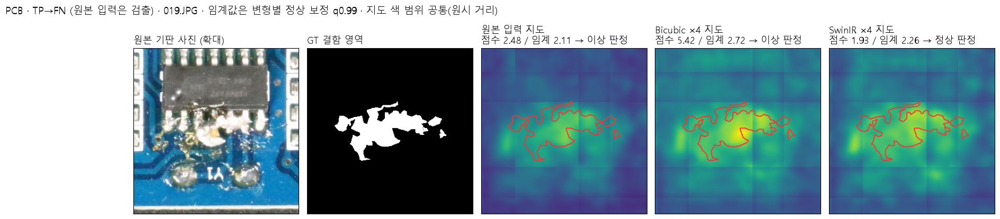
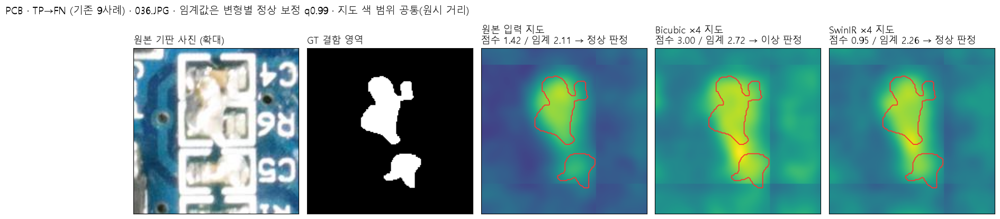
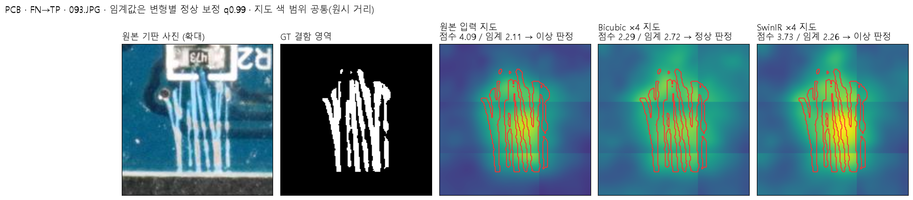
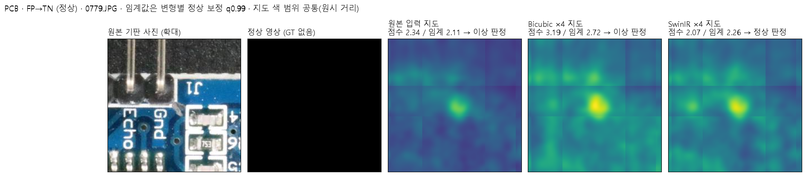

# VisA PCB 운영점 전환 사례

테스트 정상과 이상은 각 100장이다. 표에는 이미지 점수와 정상 보정 임계값, 사용한 확대 위치가 있다. [사례별 점수](../../data/visa/operating-point-cases.csv) · [테스트 200장 판정 전환](../../data/visa/decision-changes.csv)

## pcb_anomaly_019

## pcb_anomaly_036

## pcb_anomaly_093

## pcb_normal_0779

[출처와 라이선스](../../FIGURE_LICENSES.md)
