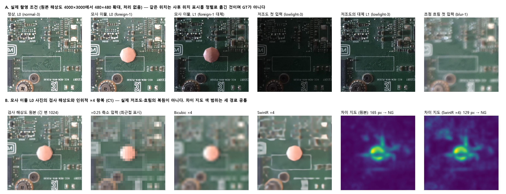
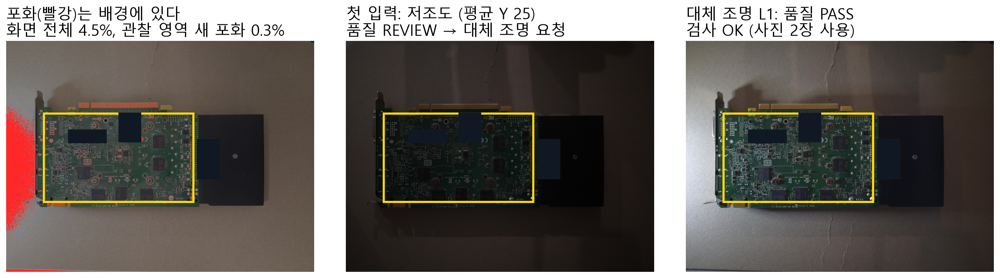
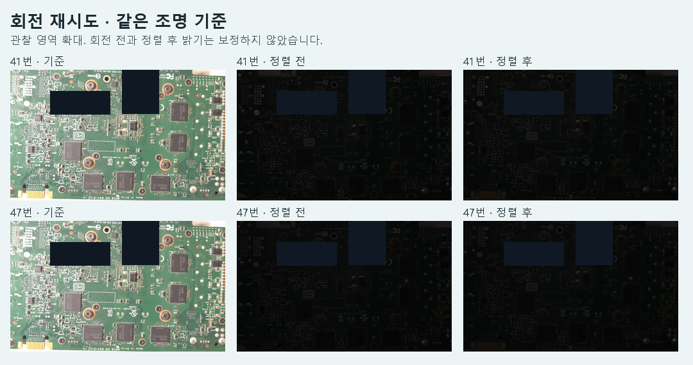

# 로컬에서 공개한 보고서 근거

[작성 인계](../../docs/REPORT_AUTHOR_HANDOFF.md) · [연구 결정 기록](../../docs/RESEARCH_EVOLUTION.md) · [기존 그림과 수치표](../README.md)

## 실물 PCB 사진

[개발 촬영 24장](photos/development/)과 [평가 촬영 50장](photos/evaluation/)은 원본 해상도로 만든 공개 사본이다. GitHub의 기존 축소 공개본과 같은 사진 번호를 쓴다. 기판 식별 스티커를 가리고 EXIF를 제거한 뒤 JPEG로 저장했다. 촬영 시 조명과 흐림은 별도 보정 없이 유지했다. [해상도 및 파일 해시](data/high-resolution-photo-index.csv)

- [개발 촬영표와 메모](data/development-capture-notes.csv) · [개발 실행 레시피](data/development-recipe.json)
- [평가 촬영표와 메모](data/evaluation-capture-notes.csv). 평가 입력의 밝기·흐림·조명 조건 표기는 촬영 계획과 반환 기록을 따른다. 측정값이 없는 시간 항목은 공란이다.
- [판독자 1 원 판독](data/reader-1-original-labels.csv) · [판독자 2 원 판독](data/reader-2-original-labels.csv). 두 표의 50장에는 참조·보정 4장이 들어 있다. [평가용 46장 재확인표](../data/phone/human-readability-46.csv)와 연결해서 읽는다.

## 추가 비교 그림

[같은 위치 확대 좌표와 처리 값](data/development-zoom-coordinates.csv)

회전 재시도에서 정렬을 복구한 41번과 47번은 모두 기존 품질 기준에서 RETAKE였다. [회전 시도 결과](../data/phone/rotation-probe.csv) · [복구 사진 품질 결과](../data/phone/rotation-recovered-quality.csv)
